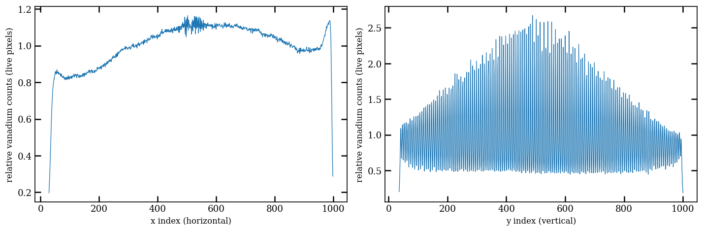

# Zero-count pixels: vanadium mask and wire profiles — local data, 2026-11-12

Phase 0 of the [pixelation-uncertainty plan](../../PixelationUncertainty_Plan.md).
The data are the small runs in `tests/data`, all from 2019–2023, because the `/HFIR` archive was not
mounted on this machine. Re-run on recent data with the command at the bottom.

## Questions

1. **Does a vanadium flood work as a dead-pixel mask?** That is, are pixels with no vanadium
   counts the detector's dead pixels, and are the zeros left after removing them just counting
   statistics?
2. **Does the fraction of zero-count pixels change along the detector's horizontal (x) and
   vertical (y) axes?** HB2B has a ³He delay-line detector, and the wires encode position.

## Method

`scripts/pixelation_study/run_zero_count_study.py` (helpers in `zero_counts.py`, unit-tested in
`tests/unit/scripts/pixelation_study/`):

- Counts are summed per pixel over all sub-runs. They come from the project file, or from
  `bank1_events/event_id` in the event file.
- **Pixel ordering was verified.** Event IDs reproduce the HB2B_938 project-file counts in all but
  215 of 1,048,576 pixels; those differ by +1 or +2, consistent with the event file's 216 extra
  events falling outside the sub-run windows.
  The image is indexed `[x, y]`, where x is horizontal: 2θ spans 17.3° along x and 0° along y,
  from PyRS's own uncalibrated geometry.
- **Dead pixel** = < 0.9 counts in vanadium run 931 (a 4 h flood with 29.6 counts per live
  pixel). This is the rule reduction already applies.
- **Each live pixel's expected count** is λᵢ = Sᵦ·vᵢ. Here Sᵦ = ΣN/Σv in its 2θ × η bin
  (0.05° × 2°), and vᵢ is the vanadium count box-averaged over 15 pixels along x.
  The averaging matters. Raw vanadium carries its own ~18 % Poisson noise, which inflates the
  predicted zeros by about 1 + λ²σ²/2. For run 1017, observed/expected zeros were 0.83 with raw
  vanadium and 0.93 with the averaged vanadium. It is applied only along x, where the
  efficiency varies slowly.
- **Zeros vs Poisson.** Observed zeros are compared with Σ exp(−λᵢ), and Σ p(1−p) gives the
  scatter, for each column (x) and row (y). The analysis keeps lines that are at most 5 % dead
  (x 29–999, y 36–1000).
- **Measured/predicted counts per line.** The script also reports ΣN/Σλ per line, and its scatter
  after removing the 1/√Σλ counting noise. This tests directly whether the vanadium's efficiency
  pattern still fits a run.

## Results

### Vanadium 931

| | |
|---|---|
| Dead pixels | 7.9 % of the detector. All but 11 are in the outer border: active area x 29–999, y 36–1000 |
| Production mask `HB2B_Mask_12-18-19.xml` | Masks 12.9 %: every dead pixel plus 52,985 live ones |
| Efficiency along x (column means) | ±12 % slow trend, no short-period structure |
| Efficiency along y (row means) | **±52 %, periodic every 6.56 rows (1.92 mm)**: ~146 bands, 0.5×–2.6× the mean. The contrast is largest at mid-height |



### Sample runs

| Run | Title | Date | Mean counts / live pixel | Zero fraction, all pixels | Zero fraction, live pixels | Share of zeros that are dead | Observed / Poisson-expected zeros | Row mismatch beyond counting noise | Column mismatch beyond counting noise |
|---|---|---|---|---|---|---|---|---|---|
| 938 | Testing | 2019-11-01 | 0.92 | 49.3 % | 44.9 % | 16 % | 0.996 | 2.2 % | 0.0 % |
| 1017 | Si422_LaB6_Calibration | 2019-11-10 | 3.65 | 15.6 % | 8.5 % | 50 % | 0.933 | 4.4 % | 0.3 % |
| 1118 | Pin test | 2019-12-19 | 0.22 | 82.1 % | 80.6 % | 10 % | 0.999 | 9.4 % | 0.0 % |
| 1431 | Pole Figure Testing 50-50 Fer/Aus | 2020-05-22 | 0.51 | 67.4 % | 64.6 % | 12 % | 0.989 | 12.8 % | 0.0 % |
| 3489 | Si331_Calibration_C501 | 2023-05-30 | 0.88 | 51.4 % | 47.3 % | 15 % | 0.971 | 12.1 % | 0.0 % |

Each run's figure (e.g. [3489](HB2B_3489_zero_profiles.png)) has four panels: the zero map, the
zero fraction per column, the zero fraction per row, and measured/predicted counts per row.
`summary.json` and `*_profiles.npz` hold every number.

## Answers

1. **The vanadium works as a dead-pixel mask, but dead pixels explain only a minority of the
   zeros.**
   - Dead pixels are the detector border (plus 11 inside), and the production mask already
     covers them all.
   - They account for 10–16 % of the zeros in low-count runs, and 50 % in run 1017.
   - The remaining zeros, in live pixels, are counting statistics. Observed zeros are within
     0.1–3 % of the Poisson prediction (7 % for the highest-count run, 1017, where any
     leftover efficiency error matters most).
   - **For the uncertainty study, most zeros are real measurements of "0 counts", not missing
     pixels.**
2. **Along the horizontal axis (x):** the zero fraction changes only because the diffraction
   pattern does (high at background, low at peaks). The vanadium describes the columns to within
   counting noise in every run, 2019–2023.
3. **Along the vertical axis (y), the zero fraction changes strongly, at the wire period.**
   - The delay-line encoding puts events preferentially on rows every 6.56 pixels (1.92 mm), so
     the zero fraction swings from row to row, e.g. 10 %–65 % in run 938.
   - The vanadium reproduces this when it was measured close in time to the sample. The
     mismatch beyond counting noise grows with time since the vanadium: 2.2 % (938), 4.4 %
     (9 days later), 9.4 % (7 weeks), 12–13 % (2020 and 2023).
   - **The vertical stripe pattern drifts, so a vanadium must be recent to describe the
     vertical efficiency.**

## Implications for the uncertainty study

- **The vertical pixel size is not the real vertical resolution.** About 146 efficiency bands
  span 965 rows. Neighbouring rows are not equal-efficiency samples, and low-efficiency rows
  hold most of the zeros.
- **The σ = 1 substitution in reduction** (see [ground truths](../../../ground_truths.md))
  therefore adds variance mainly from low-efficiency rows.
- **Full-height 2θ bins** sum over all rows, so the stripes largely average out of the intensity.
  **Narrow η wedges** (texture) cover only a few bands, so there a stale vanadium could bias
  intensities by up to ~12 %. This is untested; it belongs to Phase 1.

## Not yet established

- **Wire naming.** Which wire plane encodes y, i.e. whether "vertical wires" correspond to x
  or to y? Results here are labelled by detector axis.
- **Cause of the drift**: delay-line timing calibration, gain, or something else. Recent data
  with a vanadium taken close in time will show whether the 2.2 % baseline is the floor.
- The 7 % zero deficit at the highest count level (1017).

## Re-running on recent data

```bash
pixi run python scripts/pixelation_study/run_zero_count_study.py \
    --vanadium /HFIR/HB2B/IPTS-<ipts>/nexus/HB2B_<van>.nxs.h5 \
    --run /HFIR/HB2B/IPTS-<ipts>/nexus/HB2B_<run>.nxs.h5 --run ... \
    --mask <production mask .xml> \
    --out docs/planning/pixelation_results/<date>_<description>
```

Inputs can be event files (`.nxs.h5`) or HiDRA project files with raw counts. Pick a vanadium
taken close in time to the runs, plus one from a different cycle, to measure the drift.
