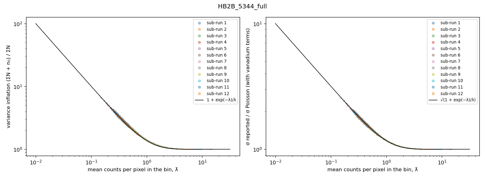
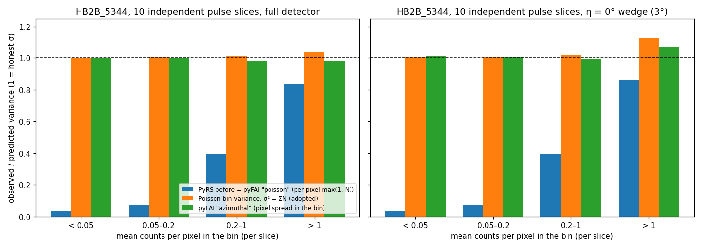

Intensity Uncertainties
#######################

This page describes how pyRS assigns an uncertainty to each point of a reduced diffraction pattern.
It explains why that uncertainty is the Poisson variance of each 2θ bin's total count, and it
summarises the evidence for this choice: measurements on HiDRA data, a comparison with pyFAI, and
Monte Carlo and real-data tests. The study is tracked in the pixelation-uncertainty plan
(issues #1106 to #1111).

.. contents::
   :local:
   :depth: 2

Summary
=======

* A reduced pattern is a 2θ histogram. Each bin sums the counts of up to ~1,300 detector pixels.
  The uncertainty of that sum is the **Poisson uncertainty of the bin's total count**,
  σ²\ :sub:`bin` = Σ N\ :sub:`i`.
* Before #1109, pyRS gave every zero-count pixel σ = 1 before summing, which is also pyFAI's
  ``poisson`` convention. A bin with n\ :sub:`0` empty pixels then got σ² = Σ N\ :sub:`i` +
  n\ :sub:`0`. At HiDRA's count levels (0.05–1 counts per pixel per sub-run) this overstated σ by up
  to **5×** in sparse bins and by 1.5–1.8× in typical background.
* Mantid ``FitPeaks`` does not rescale parameter errors by χ², so the overstated σ went straight into
  the reported peak uncertainties. It also made some weak-peak fits fail.
* Splitting real event data into independent slices shows that σ² = Σ N\ :sub:`i` matches the
  real fluctuations at every count level. HiDRA's counts behave as Poisson.

How a reduced point and its uncertainty are computed
====================================================

For a sub-run, each unmasked pixel *i* with vanadium counts V\ :sub:`i` ≥ 0.9 is assigned to the 2θ
bin containing its pixel 2θ. For each bin, pyRS forms the total counts and the total vanadium

.. math::

   N_{bin} = \sum_{i \in bin} N_i, \qquad V_{bin} = \sum_{i \in bin} V_i ,

and reports the vanadium-normalised intensity

.. math::

   I_{bin} = N_{bin} \, \frac{V_{max}}{V_{bin}} ,

where V\ :sub:`max` is the largest V\ :sub:`bin` of the pattern. The normalisation is a *ratio of
sums*: the counts are summed first and then divided by the summed vanadium. The uncertainties of
N\ :sub:`bin`, V\ :sub:`bin` and V\ :sub:`max` are propagated as independent:

.. math::

   \left(\frac{\sigma_{I}}{I}\right)^2 = \frac{\sigma^2_{N,bin}}{N_{bin}^2} + \frac{1}{V_{bin}} + \frac{1}{V_{max}} .

The vanadium terms are small, because a flood has ~17–30 counts per pixel. The data term
σ²\ :sub:`N,bin` is the subject of this page.

* **Empty bins** (N\ :sub:`bin` = 0) are reported as I = 0 and σ = 1, so that a fit never sees
  σ = 0.
* **Implementation:** ``PyHB2BReduction.histogram_by_numpy`` (``pyrs/core/reduce_hb2b_pyrs.py``).

The variance of a bin
=====================

Per pixel
---------

The counts N\ :sub:`i` of a live pixel are Poisson-distributed with mean λ\ :sub:`i`, the pixel's
expected count (its efficiency times the diffraction pattern at its 2θ and η). The variance of a
pixel is λ\ :sub:`i`. It is never 0 for a live pixel, whatever the pixel happened to record.

A single observed count is a poor estimate of λ\ :sub:`i`. At λ = 0.6, 55 % of pixels record 0, yet
each still has variance 0.6. So a *per-pixel* variance cannot be taken from the observed counts:
σ² = N\ :sub:`i` is 0 for most sparse pixels, and the substitute σ² = 1 is arbitrary. Anything that
uses pixels individually needs per-pixel variances from a model (λ̂\ :sub:`i` = efficiency ×
expected pattern). That includes a 2D fit of the detector image, or a per-pixel normalisation
Σ(N\ :sub:`i`/V\ :sub:`i`).

Per bin
-------

pyRS fits the binned pattern, not individual pixels. A sum of independent Poisson variables is itself
Poisson, so the bin total N\ :sub:`bin` has variance

.. math::

   \mathrm{Var}(N_{bin}) = \sum_{i \in bin} \lambda_i ,

whose unbiased estimate is the observed total N\ :sub:`bin` = Σ N\ :sub:`i`. A zero-count pixel adds
0 to this estimate. That is not a claim that its variance is 0: pixels that fluctuated low are
balanced, on average, by those that fluctuated high. A bin variance depends only on the bin's total
expected count, so a pixel-level model gives the same bin variance (Σ λ̂\ :sub:`i`).

The former rule
---------------

Giving each zero-count pixel σ = 1 added the number of empty pixels to the variance:

.. math::

   \sigma^2_{N,bin} = N_{bin} + n_0 .

But n\ :sub:`0` measures how sparse the pixels are, not how uncertain the total is: its expectation is
Σ e\ :sup:`−λᵢ`. For pixels with a common mean λ, the variance is overstated by the factor

.. math::

   R(\lambda) = 1 + \frac{e^{-\lambda}}{\lambda},

which is 10 at λ = 0.1, 2.2 at λ = 0.5, 1.37 at λ = 1 and 1.001 at λ = 5. It depends on counts *per
pixel*, so it is the same for wide and narrow bins and for η wedges.

When the bin estimate needs care
--------------------------------

Using the observed total as the variance (Neyman's χ²) biases a fit only when bin totals are a few
counts or fewer. Then a bin that fluctuates low is over-weighted.

* **At HiDRA's levels it is negligible:** full-detector bins hold ~80 counts even for weak data
  (~1,270 pixels × 0.066 counts per pixel), and no bias was measurable (below).
* **Empty bins** are handled by the σ = 1 rule.
* **Lower counts:** for much lower totals per bin (very narrow wedges, very short sub-runs), a
  variance from the fitted model, i.e. a second fitting pass, is the robust option.

Comparison with pyFAI
=====================

pyFAI [pyFAI]_ integrates the same way: I = Σ signal / Σ normalisation and
σ = √(Σ variance) / Σ normalisation. It offers several per-pixel error models:

* ``poisson``: per-pixel variance max(1, N\ :sub:`i`), plus the dark current. This is exactly
  pyRS's former rule, so the floor is a common convention. pyFAI is mostly used with X-ray
  detectors, where few pixels are near zero and the floor rarely matters.
* ``azimuthal``: the variance is taken from the scatter of a bin's pixels about the bin mean,
  Σ(N\ :sub:`i` − Ī·V\ :sub:`i`)² with Ī = N\ :sub:`bin` / V\ :sub:`bin`. This makes no Poisson
  assumption and is useful for non-Poisson detectors and for sigma-clipping. But it counts *real*
  differences between a bin's pixels as noise: the intensity gradient across a peak bin, texture or
  peak-shape changes around the ring, and efficiency-correction errors.
* ``hybrid``: azimuthal during sigma-clipping, Poisson at the last iteration.

On HiDRA data (below), σ² = Σ N\ :sub:`i` is honest at every count level. pyFAI's ``poisson`` floor
overstates σ up to 5× in sparse bins, and its ``azimuthal`` model is honest in sparse bins but up to
~20 % too large in high-count peak bins.

Evidence
========

1. Zero-count pixels are counting statistics
--------------------------------------------

The HiDRA detector's dead pixels (< 0.9 vanadium counts) are its border, which the production mask
covers. In live pixels, the number of zero-count pixels matches the Poisson expectation
Σ e\ :sup:`−λᵢ` to 0.1–1 % in runs from 2019 to 2025, with λ\ :sub:`i` from the 2θ × η pattern times
the vanadium efficiency. Arm scans have to be analysed per sub-run. Most zeros are real measurements
of "0 counts", not missing pixels.

The vertical efficiency is striped with the 6.56-row (1.93 mm) period of the y wire plane, which sits
behind the x plane. The x plane has half the pitch, 3.29 rows, and a weak modulation (1.2 %). The
vanadium normalisation corrects both.

2. Size of the former inflation
-------------------------------

HB2B_5344 (a Si422 arm scan, 12 sub-runs, 0.5–1.1 counts per pixel) was reduced with the
autoreduction settings: 720 bins of ~0.023°, ~1,270 pixels per bin. The former bin variance
reproduces pyRS's reported σ to 4×10\ :sup:`−16`, and the observed inflation
(N\ :sub:`bin` + n\ :sub:`0`) / N\ :sub:`bin` equals the Poisson prediction
1 + Σ e\ :sup:`−λᵢ` / Σ λ\ :sub:`i` (median ratio 0.996–1.005).

* **Background bins:** variance 2.4–3.1× too large, σ 1.5–1.8× too large.
* **Peak bins:** unaffected (1.00–1.03).
* **Unchanged by binning:** 360, 720 and 1,440 bins, and 3° η wedges, give the same median
  inflation (2.39–2.40).

   Former variance inflation (N\ :sub:`bin` + n\ :sub:`0`) / N\ :sub:`bin` (left) and
   σ\ :sub:`reported` / σ\ :sub:`Poisson` (right) for every bin of the 12 sub-runs of HB2B_5344,
   against the bin's mean counts per pixel. The black curves are 1 + e\ :sup:`−λ`/λ and its square
   root.

3. Peak fitting passes σ straight into the errors
-------------------------------------------------

Mantid ``FitPeaks``, as pyRS calls it, reports √(diagonal of the covariance) for the σ supplied, and
does not rescale by the reduced χ². In a test, doubling every σ doubled every reported error. With the
correct σ, the reported errors match the real scatter of the fitted values (0.96–1.05). Any error in
σ therefore becomes an error in the reported centre, width and intensity uncertainties. The reduced χ²
(``FitPeaks``' ``chi2`` column) was ≪ 1 under the former rule (0.19 on weak data) and is ≈ 1 with the
Poisson bin variance.

4. Monte Carlo on the real detector
-----------------------------------

A true pattern was placed on the calibrated HB2B_5344 detector, with the vanadium as the per-pixel
efficiency, stripes included: λ\ :sub:`i` = k · V\ :sub:`i` · R(2θ\ :sub:`i`) / V\ :sub:`max`. It
was Poisson-sampled 600 times at 0.066 counts per pixel, reduced with the production code, and fitted
with pyRS's ``FitPeaks`` arguments. A pull width of 1 means honest errors.

.. list-table::
   :header-rows: 1

   * - Bin variance
     - centre pull width
     - intensity pull width
     - strain scatter
     - strain bias
     - failed fits (weak peak, HB2B_3489)
   * - former, Σ N + n\ :sub:`0`
     - 0.58–0.61
     - 0.41–0.44
     - 20.1–21.1 µε
     - ≤ 1.8 µε
     - 24 %
   * - **Poisson, Σ N**
     - **0.96–1.01**
     - **0.99–1.05**
     - **19.1–19.9 µε**
     - ≤ 1 µε
     - **0 %**

Neither rule biases the fitted values when the peak model fits. The former rule over-reports the
weak-peak strain error ~1.7× and the intensity error ~2.4×, is ~5 % less precise, and lets some
weak-peak fits fail. At strong counts (0.74 per pixel) both are close to honest. This test assumes
Poisson counts; the next one does not.

5. Real data: independent event slices
--------------------------------------

Event data allow one measurement to be split into independent measurements. Each sub-run of HB2B_5344
was split into 10 interleaved pulse slices (pulse number mod 10), and each slice was reduced
separately. The observed variance of each bin's intensity across the slices was then compared with the
variance each rule predicts, pooled over bins of similar counts per pixel. A ratio of 1 means honest σ.

.. list-table::
   :header-rows: 1

   * - Bin variance (counts per pixel per slice →)
     - < 0.05
     - 0.05–0.2
     - 0.2–1
     - > 1
   * - former = pyFAI ``poisson``
     - 0.036
     - 0.07
     - 0.40
     - 0.84
   * - **Poisson, Σ N**
     - **0.999**
     - **1.005**
     - **1.013**
     - **1.04**
   * - pyFAI ``azimuthal``
     - 0.997
     - 1.000
     - 0.98
     - 0.98

These are for the full detector, 8,628 bins. A 3° η wedge and a two-slice split agree. pyFAI
``azimuthal`` drops to 0.82–0.85 in the highest-count bins of the two-slice split.

   Real HB2B_5344 data split into 10 independent pulse slices: observed / predicted variance of the
   reduced intensity, for the full detector (left) and a 3° η wedge (right).

Effect on reduced data and fits
===============================

* **Intensities:** unchanged. **σ:** smaller where pixels are sparse, unchanged in high-count bins.
* **Reported errors become honest.** Typical changes:

  - weak-peak strain errors ~2.3× smaller (HB2B_3489 Ni peaks: 85 → 37 µε median);
  - strong-peak strain errors ~5 % smaller;
  - weak-peak intensity errors ~2.4× smaller.

* **Fitted values** shift only where the pseudo-Voigt does not fully describe the peak, because the
  weights of the tails change: −5.7 µε mean on strong peaks (HB2B_5344) and +27.6 µε on weak ones
  (HB2B_3489). They are unbiased in both cases when the model fits.
* **Weak-peak fit failures** caused by the inflated background σ disappear.
* **The reduced χ²** of peak fits becomes a usable goodness-of-fit measure.
* **FitCalibration** fits peaks in η-wedge reductions, so its weights change as well. Its error estimates
  change (e.g. TTH_0 +21 % on the gold test). On HB2B_3510 its refined rotations move by up to 4.4° at an
  unchanged RMS, because they are poorly determined by its wedge residuals under either weighting. The
  ring-based calibration, the default since #1038, builds its own strip histograms and is not affected.

Limitations and open questions
==============================

* **Fit-level scatter.** In the event-split test, the real scatter of fitted peak centres between
  slices was 1.3–1.7× the reported error for every variance rule (8 peak groups). It probably comes
  from fit stability and peak-shape misfit rather than from the bin variance, but this is not yet
  established.
* **Peak shape.** HiDRA peaks are asymmetric (a high-angle tail that varies across the detector).
  This affects fitted positions much more than the variance rule does. See the peak-profile study in
  the issue tracker. The asymmetry does not change how the variance should be computed.
* **Very low bin totals.** For bins with only a few counts, a model-based variance (second fitting
  pass) avoids the Neyman bias.

Related decisions
=================

* **Detector calibration stays on the native 1024 × 1024 grid.** Grouping pixels before calibrating
  gave no gain in parameter errors or residuals, and stopped the iteration converging on one run. A
  native calibration applies exactly to grouped reductions.
* **Vertical pixel grouping is not used.** Grouping 4 or 8 rows also removes most of the former
  inflation, without shifting strain, but the Poisson bin variance does so at full resolution.
  Horizontal grouping aliases the 2θ pattern, because pyRS does not split pixels.
* **The peak profile is unchanged** (symmetric pseudo-Voigt). Asymmetric profiles improve χ² but, when
  matched with their own calibration, gave no more consistent d-spacings across the detector. The
  calibration and the sample fits must use the same profile, or d is offset by ~300 µε.

.. [pyFAI] Ashiotis G et al. 2015 J. Appl. Cryst. vol48 p510–519, "The fast azimuthal integration Python library: pyFAI"
